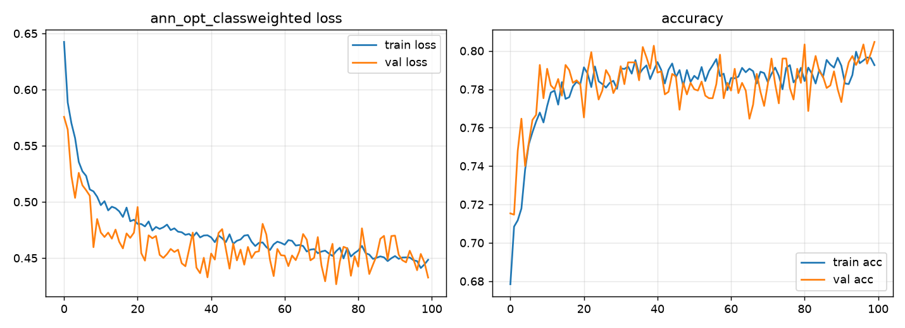
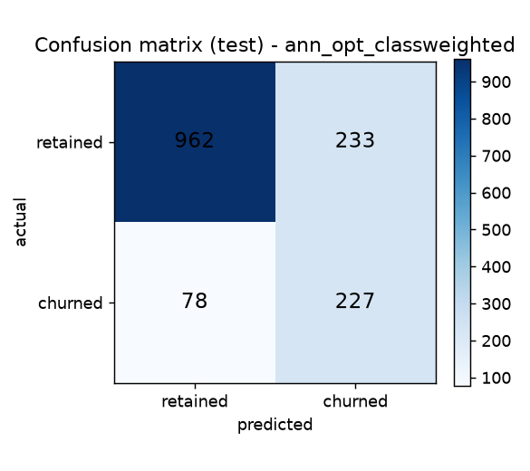

# ANN Customer Churn Prediction

End-to-end **Artificial Neural Network (TensorFlow/Keras)** binary classifier predicting
bank customer churn (`Exited`) from demographic, financial, and account features,
with an interactive **Streamlit** app for real-time inference.

## Overview & objective

Binary classification: identify customers likely to discontinue the service
(`Exited`: `0` = retained, `1` = churned). Because churners are the minority
(~20%), model selection prioritizes **F1 / ROC-AUC / PR-AUC and recall**,
not accuracy alone.

## Dataset & target

`Churn_Modelling.csv` — 10,000 rows, no missing values, no duplicates.

| Feature | Type |
|---|---|
| CreditScore, Age, Tenure, Balance, NumOfProducts, HasCrCard, IsActiveMember, EstimatedSalary | numeric |
| Geography (France/Germany/Spain) | categorical → OneHot |
| Gender (Female/Male) | categorical → Label |
| **Exited** | **target (binary)** |

Class distribution: retained 7,963 (79.6%) / churned 2,037 (20.4%).

## Technologies

Python 3.11 · TensorFlow/Keras 2.15 · scikit-learn · pandas · NumPy ·
matplotlib · Streamlit · (scikeras, tensorboard — see `requirements.txt`).

## Project structure

```
├── app.py                  # Streamlit app (fixed: cached model, form+button, validation)
├── train.py                # Reproducible pipeline: preprocess → train → compare → save → plot
├── predict.py              # Shared inference (train/serve consistency), used by app.py
├── test_verify.py          # Save/load, unseen samples, edge cases, overfitting check
├── Churn_Modelling.csv     # Dataset (preserved)
├── experiments.ipynb       # Original classification experiment (kept for history)
├── prediction.ipynb        # Original inference walkthrough (kept for history)
├── hyperparametertuningann.ipynb  # Original grid-search draft, never executed (kept)
├── salaryregression.ipynb  # Unrelated salary-regression experiment (kept, deprecated — see Limitations)
├── model.h5                # Final ANN (best by val F1)
├── scaler.pkl / onehot_encoder_geo.pkl / label_encoder_gender.pkl  # Fitted on TRAIN only
├── feature_order.json      # Canonical feature order (12 cols)
├── results/metrics.json    # Measured val + test metrics
├── results/training_curves.png / results/confusion_matrix.png
├── requirements.txt        # Pinned, verified versions
└── .gitignore
```

## Preprocessing (leakage-fixed)

1. Drop identifiers (`RowNumber`, `CustomerId`, `Surname`).
2. **Stratified** split 70/15/15 (train 7,000 / val 1,500 / test 1,500;
   churn rates 0.2037 / 0.2040 / 0.2033).
3. Fit **only on train**: `LabelEncoder` (Gender),
   `OneHotEncoder(handle_unknown='ignore')` (Geography), `StandardScaler` (all 12 features).
4. Fixed column order in `feature_order.json`; `predict.py` applies the identical pipeline.
5. Class imbalance handled via stratified splits + F1-based selection + one
   class-weighted ANN variant (`{0: 0.628, 1: 2.454}`); resampling was not needed.

The original notebooks fitted encoders/scaler on the **full dataset before
splitting** (leakage) and used a single unstratified 80/20 split with the test
set doubling as validation. Both are fixed in `train.py`.

## ANN architecture & training

Framework preserved (TensorFlow/Keras). Compared in one harness (Adam, batch 32,
binary cross-entropy, EarlyStopping + ReduceLROnPlateau):

| Config | Val acc | Val F1 | Val ROC-AUC | Val PR-AUC | Best epoch |
|---|---|---|---|---|---|
| baseline 64×32, lr 0.01, no reg (original-style) | 0.8407 | 0.5286 | 0.8172 | 0.6235 | 3 |
| opt 64×32, dropout 0.3, L2 1e-4, lr 0.001 | 0.8720 | 0.6000 | 0.8798 | 0.7224 | 52 |
| small 32×16, dropout 0.2, lr 0.001 | 0.8687 | 0.5817 | 0.8810 | 0.7252 | 76 |
| **opt + class_weight (FINAL)** | 0.8047 | **0.6219** | 0.8788 | 0.7168 | 75 |
| LogReg (baseline) | 0.8100 | 0.2893 | 0.7846 | 0.5067 | – |
| RandomForest balanced (baseline) | 0.8567 | 0.6362 | 0.8755 | 0.6895 | – |

Selected **opt + class_weight** (best ANN by val F1). Note: RandomForest has a
marginally higher val F1 (0.6362) but lower recall (0.614 vs 0.788) and lower
PR-AUC; for churn detection, catching churners (recall) matters, and this repo
is ANN-focused — both numbers are reported honestly in `results/metrics.json`.

## Final evaluation (untouched test set, n=1,500)

| Metric | Value |
|---|---|
| Accuracy | 0.7927 |
| Precision | 0.4935 |
| Recall | 0.7443 |
| F1 | 0.5935 |
| ROC-AUC | 0.8603 |
| PR-AUC | 0.7185 |

Confusion matrix (test): `[[962, 233], [78, 227]]`
(rows actual retained/churned, cols predicted retained/churned).

Train/val/test gap — acc 0.8166 / 0.8047 / 0.7927, F1 0.6393 / 0.6219 / 0.5935,
ROC-AUC 0.8969 / 0.8788 / 0.8603 — small and healthy (the original run showed
train loss ~0.24 vs val loss ~0.50, i.e. clear overfitting; lr 0.01 was also too
high — its best epoch was 3).




Unseen-sample spot checks (`test_verify.py`): high-risk profile p=0.979 → churn;
low-risk p=0.012 → retained; original notebook example (France/Male/40) p=0.140
→ retained. Edge cases (unknown Geography/Gender, missing field) raise clear
`ValueError`s.

## Installation & run

```powershell
git clone https://github.com/bharat-02/ANN-classification.git
cd ANN-classification
python -m venv venv
.\venv\Scripts\Activate.ps1
python -m pip install -r requirements.txt
```

Train + evaluate + save artifacts + plots:

```powershell
.\venv\Scripts\python.exe train.py
```

Verify (save/load, unseen samples, edge cases, overfitting check):

```powershell
.\venv\Scripts\python.exe test_verify.py
```

Launch the app:

```powershell
python -m streamlit run app.py
# http://localhost:8501
```

Programmatic inference:

```python
from predict import predict_churn
proba, label = predict_churn({"CreditScore": 600, "Geography": "France",
    "Gender": "Male", "Age": 40, "Tenure": 3, "Balance": 60000.0,
    "NumOfProducts": 2, "HasCrCard": 1, "IsActiveMember": 1,
    "EstimatedSalary": 50000.0})
```

## GPU / CPU

Verified: `tf.config.list_physical_devices()` → CPU only, no GPU devices.
The installed `tensorflow==2.15.0` is the Intel CPU build, so the RTX 3050 is
**not** used; training runs on CPU (fast enough here: 7k rows, small nets).
GPU training would require an NVIDIA CUDA-enabled TF build (typically via WSL2),
which was intentionally not introduced to avoid breaking the working env.

## Limitations & reproducibility

- Fixed seed (42) for splits/seeds; CPU results are reproducible, GPU would add variance.
- `salaryregression.ipynb` (predicting `EstimatedSalary`, MAE ≈ 50k ≈ mean-prediction)
  is unrelated to this classification objective, uses `Exited` as an input feature,
  and used to overwrite the shared `scaler.pkl` with an incompatible feature set —
  it is kept only as history and **deprecated**; `train.py` artifacts are canonical.
- `hyperparametertuningann.ipynb` grid search was never executed; `train.py` replaces it.
- Single 70/15/15 split (no k-fold) to keep compute reasonable.
- Secrets/model-registry/versioning out of scope; `model.h5` + pickles are committed
  (small, ~70 KB total) because the Streamlit app loads them directly.
