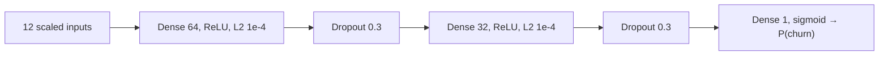

# ANN Customer Churn Prediction

A beginner-friendly, end-to-end **Artificial Neural Network (TensorFlow/Keras)**
project that predicts whether a bank customer will leave (**churn**). It covers
the full workflow — data validation, leak-free preprocessing, ANN training with
model comparison, a shared prediction pipeline, an interactive **Streamlit**
app, feature-dependency analysis, and automated verification tests.

> A predicted churn probability is a **model estimate, not a guarantee** that
> a customer will actually leave.

## Contents

- [A. Project overview](#a-project-overview)
- [B. Architecture and directory structure](#b-architecture-and-directory-structure)
- [C. Dataset](#c-dataset)
- [D. Data preprocessing](#d-data-preprocessing-trainpy)
- [E. ANN theory + the actual network](#e-ann-theory--the-actual-network)
- [F. Training and evaluation](#f-model-training-and-evaluation)
- [G. Churn threshold and prediction logic](#g-churn-threshold-and-prediction-logic)
- [H. Installation and setup (Windows + VS Code)](#h-installation-and-environment-setup)
- [I. Using the Streamlit app](#i-using-the-streamlit-app)
- [J. Feature dependency analysis](#j-feature-dependency-analysis)
- [K. Testing and troubleshooting](#k-testing-and-troubleshooting)
- [L. Dependencies and reproducibility](#l-dependencies-and-reproducibility)
- [M. Security, privacy, and Git policy](#m-security-privacy-and-git-policy)
- [N. Future improvements](#n-future-improvements-not-implemented)

## A. Project overview

**Classification problem.** Each row describes one bank customer. The target
`Exited` is `1` if the customer left the bank (churned) and `0` if they stayed
(retained). The task: estimate P(churn) from demographics, finances, and
account behavior.

**What "churn" means here.** A churned customer closed their relationship with
the bank. Finding likely churners early lets a business act (retention offers,
service fixes) before revenue is lost.

**Why an ANN fits.** Churn depends on *interactions* (e.g. older + inactive +
few products), not just single columns. A feed-forward network learns such
non-linear combinations from scaled numeric and encoded categorical inputs,
outputting one calibrated-ish probability via a sigmoid neuron.

**Objectives.** (1) Reproducible, leak-free training; (2) honest validation
against baselines on an untouched test set; (3) one shared inference path for
training, scripts, and the app; (4) a fixed, documented decision rule.

**Capabilities.** Trains 4 ANN variants + 2 sklearn baselines, saves the best
(by validation F1), serves real-time predictions in Streamlit, and verifies
itself with `test_verify.py`.

**Limitations.** Single 70/15/15 split (no k-fold); moderate imbalance
(~20% churn) limits precision; probabilities are uncalibrated estimates; the
data is a static snapshot (distributions can drift).

**How a user gets a prediction.** Open the app, fill the 10 customer fields,
press **Predict** → see the churn probability, the fixed threshold note, and
the verdict ("likely to churn" / "not likely to churn").

## B. Architecture and directory structure

Actual repository layout (`venv/` and caches omitted):

```text
annclassification/
├── app.py                      # Streamlit UI (essential)
├── predict.py                  # shared inference pipeline (essential)
├── config.py                   # single authoritative CHURN_THRESHOLD (essential)
├── train.py                    # reproducible training + comparison (essential)
├── test_verify.py              # automated checks (essential)
├── Churn_Modelling.csv         # dataset (essential, preserved)
├── model.h5                    # final trained ANN (generated, tracked — app needs it)
├── scaler.pkl                  # fitted StandardScaler (generated, tracked)
├── onehot_encoder_geo.pkl      # fitted OneHotEncoder (generated, tracked)
├── label_encoder_gender.pkl    # fitted LabelEncoder (generated, tracked)
├── feature_order.json          # canonical 12-column order (generated, tracked)
├── results/
│   ├── metrics.json            # measured val + test metrics (generated)
│   ├── training_curves.png     # loss/accuracy curves (generated)
│   └── confusion_matrix.png    # test confusion matrix (generated)
├── feature_dependency/         # input/target association analysis (optional)
│   ├── analyze_dependencies.py
│   ├── README.md
│   ├── numerical_correlations.csv / feature_associations.csv
│   ├── feature_target_analysis.csv / vif.csv
│   └── plots/ (4 PNGs)
├── experiments.ipynb          # original classification experiment (history)
├── prediction.ipynb           # original inference walkthrough (history)
├── hyperparametertuningann.ipynb  # grid-search draft, never executed (history)
├── salaryregression.ipynb     # unrelated salary experiment, deprecated (history)
├── requirements.txt            # pinned dependencies (essential)
├── .gitignore                  # exclusion policy (essential)
└── README.md                   # this file
```

Flow: `Churn_Modelling.csv` → `train.py` → `model.h5` + pickles →
`predict.py` (used by `app.py` and `test_verify.py`).

**Essential vs generated.** Essential: `app.py`, `predict.py`, `config.py`,
`train.py`, `test_verify.py`, dataset, `requirements.txt`, `.gitignore`.
Generated but intentionally tracked (small, and the app loads them):
`model.h5`, `*.pkl`, `feature_order.json`, `results/`. Optional/history:
notebooks and `feature_dependency/`. Regenerable junk (`__pycache__/`,
`logs/`, `venv/`) is git-ignored, never committed.

## C. Dataset

- **File:** `Churn_Modelling.csv` (classic bank-churn table, same shape as the
  public "Churn_Modelling" dataset). **Shape: 10,000 rows × 14 columns.**
- **Target `Exited`:** `0` = retained (7,963 / 79.6%), `1` = churned
  (2,037 / 20.4%). Imbalanced — accuracy alone would mislead.
- **Quality:** 0 missing values, 0 duplicate rows (checked in code at load).
- **Dropped identifiers:** `RowNumber`, `CustomerId`, `Surname` (no signal).

| Feature | Meaning | Type / format | Observed range / values |
|---|---|---|---|
| CreditScore | Credit score | int 350–850 | 350 – 850 |
| Geography | Country branch | categorical | France, Spain, Germany |
| Gender | — | categorical | Female, Male |
| Age | Years | int 18–92 | 18 – 92 |
| Tenure | Years with bank | int 0–10 | 0 – 10 |
| Balance | Account balance | float ≥ 0 | 0 – 250,898.09 |
| NumOfProducts | Products held | int 1–4 | 1 – 4 |
| HasCrCard | Owns credit card | binary 0/1 | 0, 1 |
| IsActiveMember | Active member | binary 0/1 | 0, 1 |
| EstimatedSalary | Estimated salary | float | 11.58 – 199,992.48 |
| Exited (target) | Left the bank | binary | 0 retained / 1 churned |

No private-customer content is reproduced here beyond aggregate statistics.

## D. Data preprocessing (`train.py`)

1. Load CSV; assert binary target and known Geography/Gender values.
2. Drop `RowNumber`, `CustomerId`, `Surname`.
3. **Stratified split, seed 42:** 70% train (7,000) / 15% val (1,500) /
   15% test (1,500); churn rates 0.2037 / 0.2040 / 0.2033.
4. **Fit on train only** (leakage prevention): `LabelEncoder` (Gender),
   `OneHotEncoder(handle_unknown="ignore")` (Geography → 3 columns),
   `StandardScaler` (all 12 features). Val/test are only *transformed*.
5. Fixed column order saved to `feature_order.json`; `predict.py` applies the
   identical steps at inference.
6. **Imbalance:** stratified splits + F1/ROC-AUC/PR-AUC selection + one
   class-weighted ANN (`{0: 0.628, 1: 2.454}`); no resampling was needed.

Why it matters: ANNs need similarly-scaled inputs (gradient descent
converges poorly when Balance ~10⁵ and Age ~10¹ share a network), and
fitting scalers/encoders on train only keeps val/test honest — the original
notebooks fitted them on the full data (leakage), which this pipeline fixes.

## E. ANN theory + the actual network

A neuron computes `z = w·x + b`, then a non-linear **activation** `a = f(z)`.
Stacked layers let the network compose simple patterns into complex ones.
**Forward propagation** pushes inputs → hidden layers → output probability.
**Loss** (here `binary_crossentropy`) measures wrongness; **backpropagation**
sends gradients backward and **gradient descent** (via the **optimizer**)
nudges weights to reduce loss. The **learning rate** scales each nudge.
An **epoch** = one full pass over the training data; a **batch** (here 32)
is the mini-sample per update; the **validation** split tunes/stops training.
**Overfitting** = memorizing train noise (train ≫ val performance);
**dropout** (randomly silencing neurons in training) and **L2**
(penalizing large weights) combat it; **underfitting** = too simple to learn.

**Actual final ANN** (`train.py:build_ann`, best config
`ann_opt_classweighted`, 2,945 params):



Training: Adam lr 0.001, batch 32, ≤100 epochs, EarlyStopping on `val_loss`
(patience 12, restore best; best epoch 75) + ReduceLROnPlateau (×0.5,
patience 5, min 1e-6), class weights above. Dropout/L2 are training-only.

## F. Model training and evaluation

- **Framework:** TensorFlow/Keras 2.15 (CPU build; `Sequential` API).
- **Reproducibility:** `SEED = 42` (Python, NumPy, TF, splits, sklearn
  estimators); fixed 70/15/15 stratified split; artifacts + `metrics.json`
  regenerate via `.\venv\Scripts\python.exe train.py`.
- **Compared** (same splits/harness): baseline-style ANN (64×32, lr 0.01, no
  reg), tuned ANN (64×32, dropout 0.3, L2, lr 0.001), small ANN (32×16),
  tuned + class weights (**selected**, best ANN by **val F1**), plus
  LogisticRegression and balanced RandomForest baselines.

| Model (validation, n=1,500) | Acc | F1 | ROC-AUC | PR-AUC |
|---|---|---|---|---|
| ann_baseline_64x32_lr0.01 | 0.8407 | 0.5286 | 0.8172 | 0.6235 |
| ann_opt_64x32 | 0.8720 | 0.6000 | 0.8798 | 0.7224 |
| ann_small_32x16 | 0.8687 | 0.5817 | 0.8810 | 0.7252 |
| **ann_opt_classweighted (final)** | 0.8047 | **0.6219** | 0.8788 | 0.7168 |
| logreg | 0.8100 | 0.2893 | 0.7846 | 0.5067 |
| randomforest_balanced | 0.8567 | 0.6362 | 0.8755 | 0.6895 |

Honest note: RandomForest's val F1 (0.6362) slightly beats the final ANN, but
its recall (0.614 vs 0.788) and PR-AUC are lower — for churn-finding, recall
matters, and this repo is ANN-focused. Both numbers are in
`results/metrics.json`.

- **Final, untouched test set (n=1,500):** acc **0.7927**, precision
  **0.4935**, recall **0.7443**, F1 **0.5935**, ROC-AUC **0.8603**,
  PR-AUC **0.7185**. Confusion matrix `[[962, 233], [78, 227]]`
  (rows actual retained/churned; cols predicted retained/churned).
  See `results/confusion_matrix.png` and `results/training_curves.png`.
- **Generalization:** train/val/test acc 0.8166 / 0.8047 / 0.7927 —
  small healthy gaps (the original notebook showed clear overfitting:
  train loss ~0.24 vs val loss ~0.50). Class imbalance caps precision:
  catching 74% of churners costs false alarms (~0.49 precision).

## G. Churn threshold and prediction logic

- Fixed constant **`CHURN_THRESHOLD = 0.5`**, defined exactly once in
  **`config.py`**. Users **cannot** change it in the UI (no control exists).
- `predict_churn(payload) -> (proba, label)` with
  `label = int(proba >= CHURN_THRESHOLD)`.
- **Positive class:** `1` = churned. The model is one sigmoid neuron trained
  on `y = Exited`, so `model.predict(x)[0][0]` **is** P(churn) — no column
  mapping needed (verified in code, not assumed).
- **Boundary:** `proba == 0.5` → churn (`>=`, same as training labels).
- `app.py`, `predict.py`, `train.py`, `test_verify.py` all import the same
  constant — no duplicates, no obsolete controls or conflicting values.

## H. Installation and environment setup

Prerequisites: Windows 64-bit, VS Code, Python **3.11** (venv runs 3.11.6;
matching `requirements.txt`). No API keys or env vars needed.

```powershell
cd 'C:\Users\lenovo\Desktop\New folder\Python\ML\4. DL\ANN\annclassification'
python -m venv venv
.\venv\Scripts\Activate.ps1
python -m pip install -r requirements.txt
```

Notes: if activation is blocked, run
`Set-ExecutionPolicy -Scope CurrentUser RemoteSigned` once. Use
`.\venv\Scripts\python.exe` explicitly if `python` resolves elsewhere.
Then (only if retraining): `.\venv\Scripts\python.exe train.py` regenerates
`model.h5`, pickles, `feature_order.json`, `results/`. Launch the app:

```powershell
.\venv\Scripts\python.exe -m streamlit run app.py
# http://localhost:8501
```

## I. Using the Streamlit app

1. Start it (command above). 2. Fill the form (defaults: Age 35, Credit 650,
Balance 50,000, Salary 80,000, Tenure 3, Products 1; constrained
selectboxes/sliders/number ranges). 3. Press **Predict**. 4. Read the
**Churn probability**, the fixed-threshold caption (`0.50`), and the verdict.
The 0.5 rule from §G is applied. Missing/invalid inputs can't occur via the
constrained widgets; unknown categories or missing artifacts surface as
`st.error` messages (the backend raises `ValueError`/`FileNotFoundError`).
No screenshots are included (none were captured from a real run).

## J. Feature dependency analysis

`feature_dependency/` studies input↔input and input↔target links (train
split only, seed 42 — association work never touches val/test, so no
leakage into selection). Run:

```powershell
.\venv\Scripts\python.exe feature_dependency\analyze_dependencies.py
```

Outputs: `numerical_correlations.csv` (Pearson + Spearman),
`feature_associations.csv` (Cramér's V, correlation ratio η), `vif.csv`,
`feature_target_analysis.csv` (point-biserial r, single-feature AUC, mutual
info, per-category churn rates), plus 4 plots in `plots/`.
Key results: no multicollinearity (VIF 1.00–1.11); strongest numeric pair
Balance×NumOfProducts r ≈ −0.31; Geography×Balance η ≈ 0.40; most
churn-informative: Age (AUC 0.72), IsActiveMember, Balance, Geography
(Germany churns ~0.33 vs ~0.16). **Correlation ≠ causation**, and nothing was
dropped from the ANN on this basis — see its README.

## K. Testing and troubleshooting

Run: `.\venv\Scripts\python.exe test_verify.py` — checks artifact loading,
unseen samples, edge cases, train/val/test gaps, fixed-threshold behavior
(below/at/above 0.5, `>=` boundary, kwarg rejection), single-definition
scan, and UI-control absence. All pass at time of writing.

| Issue | Cause | Fix (verified) |
|---|---|---|
| `ImportError: cannot import name 'CHURN_THRESHOLD'` | App + `predict.py` from mismatched versions (old file lacks the name), wrong folder/venv | Use this folder's files with `.\venv\Scripts\python.exe`; confirm with `... -c "import predict; print(predict.__file__)"` |
| `TypeError: predict_churn() got an unexpected keyword argument 'threshold'` | Caller passes `threshold=`; current signature is `predict_churn(payload)` (fixed threshold by design) | Call `predict_churn(payload)`; constant lives in `config.py` |
| Missing deps (`ModuleNotFoundError`) | Wrong interpreter | Activate venv / use `.\venv\Scripts\python.exe -m pip install -r requirements.txt` |
| Missing/incompatible artifacts | `model.h5`/pickles absent or stale | Re-run `train.py`; app shows a clear error message |
| Feature-order mismatch | Custom inference skipping `feature_order.json` | Always go through `predict.predict_churn` |
| TF/CUDA warnings, CPU-only | TF 2.15 Intel build has no GPU support | Expected; RTX 3050 unused, CPU training is fast enough here |
| Wrong class mapping | Assuming 2nd softmax column = churn | N/A: single sigmoid output trained on `Exited` is P(churn) |
| Streamlit won't start | Broken system Python / wrong cwd | venv Python + project dir (see §H); health endpoint `/_stcore/health` → 200 |

## L. Dependencies and reproducibility

| Package | Version | Purpose |
|---|---|---|
| tensorflow / keras | 2.15.0 | ANN training + inference (`tf.keras`) |
| scikit-learn | 1.9.1 | encoders, scaler, splits, baselines, metrics |
| pandas / numpy | 3.0.6 / 1.26.4 | data handling, numerics |
| scipy | 1.17.1 | stats for `feature_dependency` |
| matplotlib | 3.11.2 | curves, matrices, analysis plots |
| streamlit | 1.60.0 | web UI |
| scikeras / tensorboard | 0.12.0 / 2.15.2 | (grid-search draft / training logs) |

Seeds: `SEED = 42` everywhere (Python/NumPy/TF/splits/estimators) +
`mutual_info random_state=42`. Artifacts regenerate deterministically on CPU
via `train.py` (GPU would add variance).

## M. Security, privacy, and Git policy

No credentials exist in the repo; nothing requires env secrets (a future
`.streamlit/secrets.toml` would be ignored). `venv/`, `__pycache__/`, logs,
`.env`, backups, and OS/editor files are git-ignored. Note: `.gitignore`
only stops *untracked* files — `model.h5`/`*.pkl`/`results/` are already
tracked on purpose (small, and the app loads them). **All current changes
stay local — do not commit, push, or publish anything to GitHub without
explicit authorization.**

## N. Future improvements (not implemented)

- k-fold cross-validation and a held-out calibration check (e.g. reliability
  curve + temperature/Platt scaling — probabilities are currently uncalibrated).
- Explainability (permutation importance or SHAP) to justify individual
  predictions.
- Threshold tuning on validation PR-curve *if* business costs justify it
  (would require re-evaluation + docs update, not a silent change).
- Class-imbalance alternatives (focal loss), drift monitoring, CI running
  `test_verify.py`, and a versioned model registry instead of committing
  binaries.
